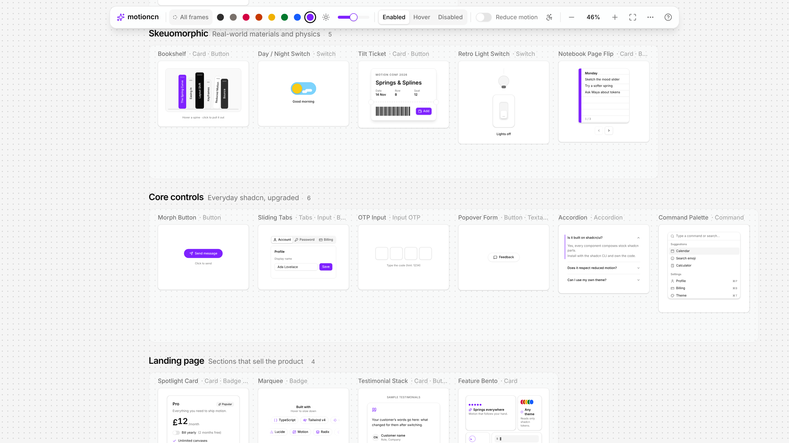
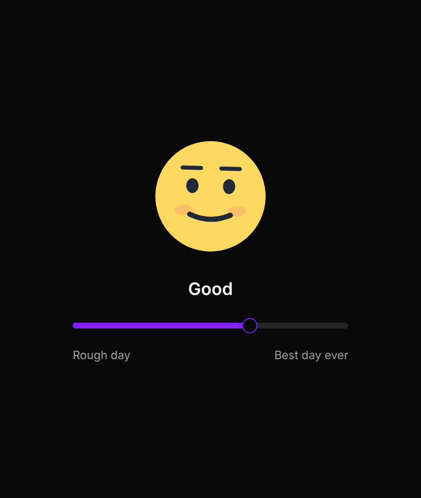
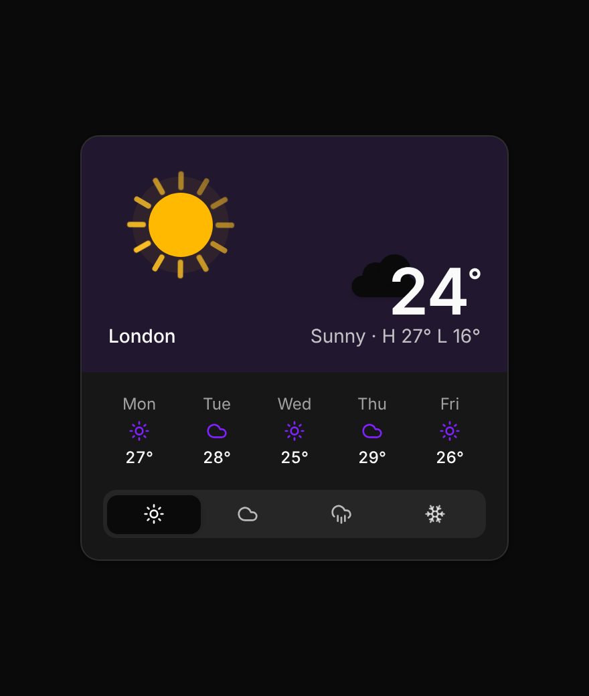
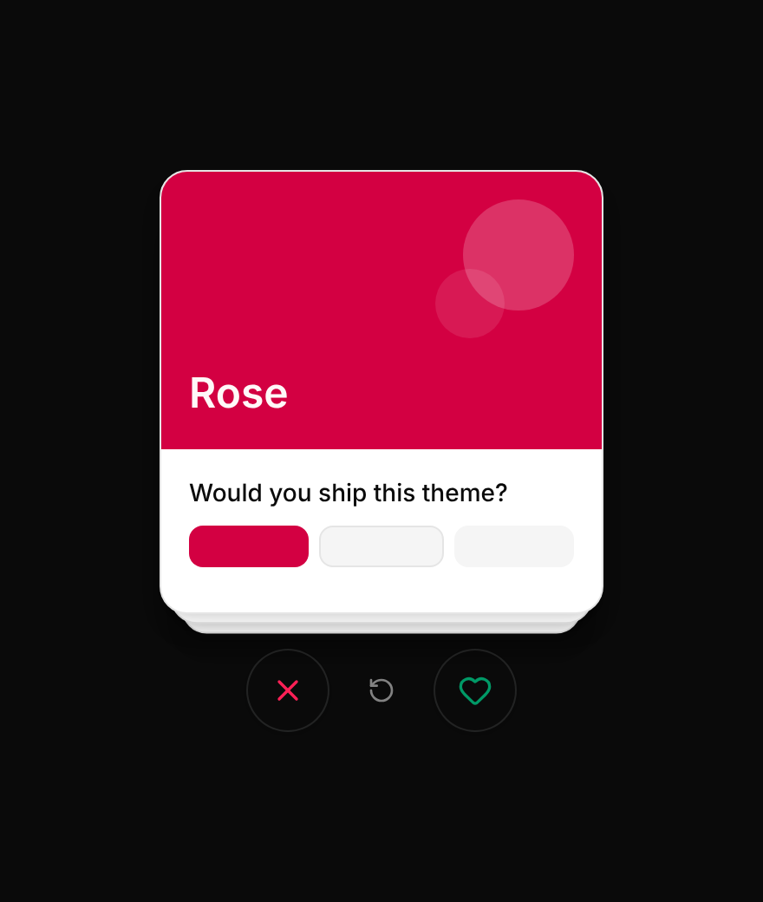
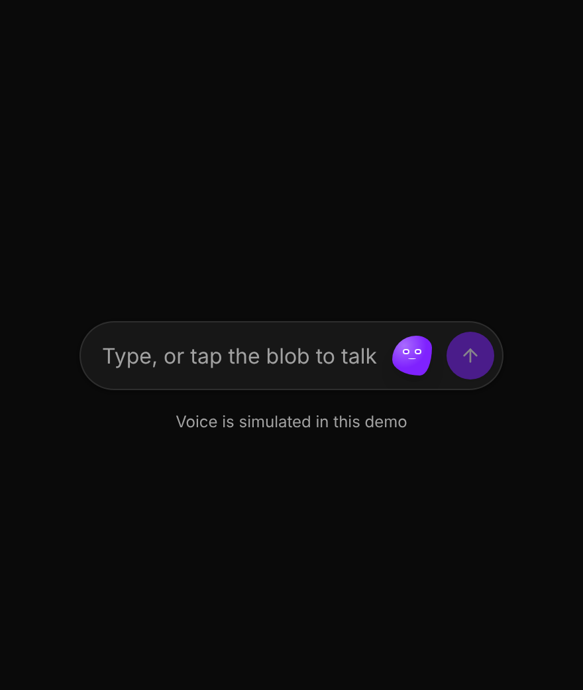

<div align="center">

# ✨ motioncn

**Animated, accessible extensions for [shadcn/ui](https://ui.shadcn.com) — explored on a Figma‑style infinite canvas.**

38 components · 8 categories · 8 themes × light/dark · WCAG AA · install with the shadcn CLI




</div>

## Why motioncn?

shadcn gives you great, ownable building blocks. motioncn adds the **feel**: springs, gestures, layout transitions and small delights. Every component is still plain shadcn underneath:

- 🧱 **Built on stock shadcn**: each component composes `components/ui`, so your theme and tokens just work.
- 🎞️ **One animation runtime**: [Motion](https://motion.dev) (`motion/react`), and every component respects reduced motion.
- 🎨 **Theme‑proof**: preview in 8 shadcn themes, light and dark, or paste your own theme CSS from ui.shadcn.com/themes or tweakcn.
- ♿ **Accessible by default**: a built‑in hover inspector checks contrast, target size, names and keyboard access. 0 failures across all themes.
- 🔀 **Every state, visible**: toggle Enabled, Hover and Disabled on any frame to see how each animation behaves.
- 📦 **Copy or install**: view the source in the code panel, or `npx shadcn add` straight from the registry.

## A taste

| Mood Slider | Weather | Swipe Cards | Voice ↔ Text |
| :---: | :---: | :---: | :---: |
|  |  |  |  |

> These are stills. Run the playground to feel the springs. 😉

## Quick start

```bash
git clone https://github.com/elenichas/motioncn.git
cd motioncn
npm install
npm run dev              # http://localhost:5173
```

| Script | What it does |
| --- | --- |
| `npm run dev` | Starts the playground |
| `npm run build` | Generates the registry, typechecks and builds the static site into `dist/` |
| `npm test` | Verifies each registry item installs on its own |

## Install components

Every component is a shadcn registry item:

```bash
npx shadcn@latest add https://YOUR-DOMAIN/r/mood-slider.json   # one component
npx shadcn@latest add https://YOUR-DOMAIN/r/all.json           # all 38
```

`registry.json` and `public/r/*.json` are **generated from the component files**:
- `scripts/build-registry.mjs` reads each file's imports to work out its stock shadcn components, npm packages and motioncn helpers.
- The description comes from the JSDoc above the component.
- `shadcn build` validates and emits the items.

Notes:
- Items depend on **stock** shadcn components.
- Two small accessibility patches in this repo are optional upgrades:
  - Slider forwards `aria-label` to its thumb.
  - Inactive Tabs triggers use `text-foreground/70` for AA contrast.
- `demo-state.tsx` comes along with each component. Outside the playground every component is simply enabled.

## Deploy (makes the install commands real)

`vercel.json` and `netlify.toml` are included.
1. Push to GitHub and import the repo on Vercel or Netlify. Build `npm run build`, output `dist`.
2. Set `REGISTRY_URL` and `VITE_REGISTRY_URL` to the live origin, e.g. `https://motioncn.vercel.app`.
3. Redeploy.

Until then, install commands use the placeholder `motioncn.example.com`. CI (`.github/workflows/ci.yml`) runs the build and the registry check on every push.

## Tests

| Command | What it checks |
| --- | --- |
| `npm run registry:verify` | Installs every registry item on its own into an empty project and typechecks it |

## The playground

**Toolbar (one set of controls).**
- Theme, light/dark, radius and component state edit *all frames*.
- Click a frame and the same controls edit *only that frame*.
- Frame actions: view code (`C`), zoom to frame, show all states, compare themes, remix, duplicate, remove.
- Every control has a tooltip.

**More menu**

| Item | What it does |
| --- | --- |
| Import theme | Paste CSS from ui.shadcn.com/themes or tweakcn. It becomes a theme you can apply anywhere. |
| Share layout | A link (when deployed) or a code that restores theme, mode, radius, state and every frame. The canvas also auto-saves in your browser. |
| Accessibility report | Scans every component and lists the results. Copy as Markdown. |
| Remix canvas | Random theme, mode and radius. The frame-level Remix shuffles one frame. |
| List view | All components in a scrolling list. This is the default on small screens. |
| Reset layout | Frames back in place; copies and per-frame settings removed. |

**Spring Lab** sits next to "Start here". Tune stiffness, damping and mass, watch the preview and curve, and copy the Motion `transition`.

**Accessibility check** (the toolbar button). Hover anything in a frame to see:
- text contrast against the real composited background
- non-text contrast
- font size
- target size (2.5.8, with the spacing exception)
- accessible name
- keyboard focusability

Each frame shows a summary badge.

**Embed a single component:** `/?embed=mood-slider&state=hover&mode=dark&theme=rose`. Add `&static=1` to reduce motion.

**Canvas controls**

| Action | How |
| --- | --- |
| Pan | Drag empty canvas, scroll, middle-mouse, Space + drag, or two fingers |
| Zoom | Ctrl/⌘ + scroll, pinch, `+` / `-`, or the zoom bar |
| Fit / 100% | `Shift+1` / `Shift+0` |
| Move a frame | Drag its title |
| Zoom to a frame | Double-click its title |
| Code for the selected frame | `C` |
| Deselect / close panel | `Esc` |
| Remove the selected frame | `Delete` |

Frames far off-screen use `content-visibility: auto`, so the browser skips rendering them.

## Catalogue (38 components, 8 categories)

| Category | Components |
| --- | --- |
| Fun widgets | Weather, Music Player, Social Post, Star Rating, Dock, Pomodoro Timer |
| Swipe & gesture | Swipe Cards, Notification Stack, Todo Checklist, Swipe to Delete, Slide to Confirm |
| Sliders | Mood Slider, Price Range, Volume Knob, Timeline Scrubber |
| Data & charts | Filter Chart, Stat Card, Donut Breakdown |
| Skeuomorphic | Bookshelf, Day/Night Switch, Tilt Ticket, Retro Light Switch, Notebook Page Flip |
| Core controls | Morph Button, Sliding Tabs, OTP Input, Popover Form, Accordion, Command Palette |
| Landing page | Spotlight Card, Marquee, Testimonial Stack (placeholder copy), Feature Bento |
| AI | Reasoning, Prompt Input, Agent Task, Voice ↔ Text Input (simulated voice), Image Generation (illustrative art) |

## The rules every component follows

1. **Built on shadcn.** Each one composes stock components from `components/ui`. Where the animation needs new inner markup (Switch, Checkbox), it uses the same Radix primitive and shadcn classes.
2. **Adds motion.** Springs, gestures, layout transitions or a delightful detail.
3. **Three states.** `useDemoState()` / `useHover()` (`components/motion/demo-state.tsx`):
   - *Hover* plays the hover animation without a pointer. Elements marked `data-hover-target` also get their `hover:` styles.
   - *Disabled* uses `<fieldset disabled>`, and each component turns off its gestures.
4. **WCAG AA.** It passes the built-in scan in all 8 themes, light and dark. Rose, Orange, Green, Blue and Violet primaries are darkened from the official presets, so white text on them reaches 4.5:1.
5. **Installs alone.** `npm run registry:verify` must pass.

## Structure

```
src/
  components/ui/        stock shadcn components
  components/motion/    the 38 extensions + helpers (demo-state, slot-number, text-shimmer)
  canvas/               canvas, frames, toolbar, code panel, dialogs, list/embed views, Spring Lab
  lib/                  themes (+ CSS import), a11y checks, source info, layout save/share
  registry.tsx          categories and canvas layout
scripts/                registry build + verify
```

## Adding a component

1. Create `src/components/motion/my-thing.tsx` on top of shadcn components, with a JSDoc above the export.
2. Register it in `src/registry.tsx` (with `file`) and add it to a category.
3. Add a hover animation and a disabled look.
4. Run `npm test -- --update-snapshots` for its baselines, then check it in the accessibility report.

Licence: MIT. See `LAUNCH.md` for the launch checklist and post drafts.
